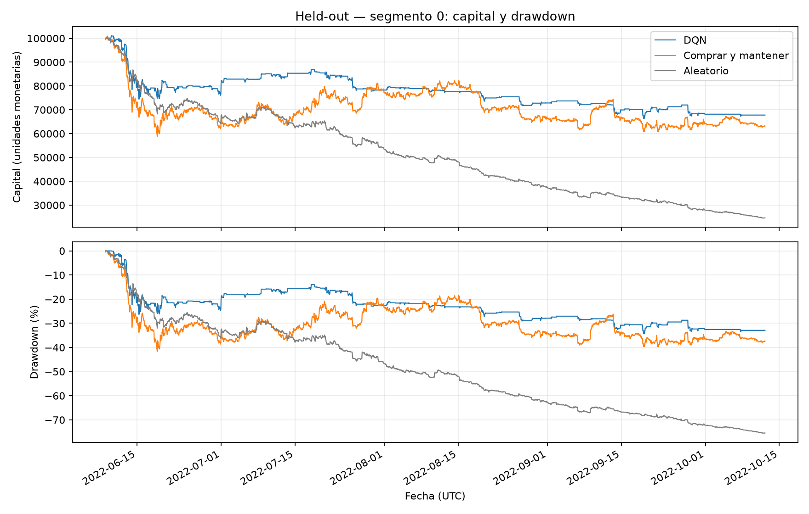
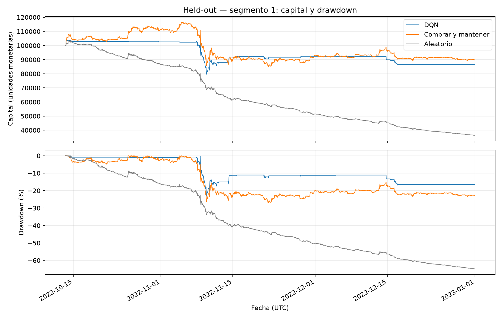
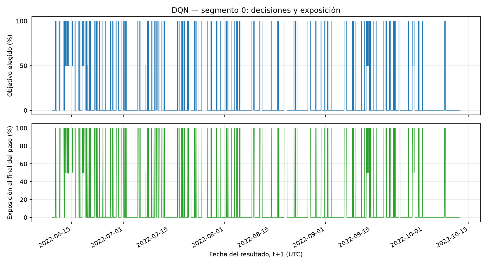
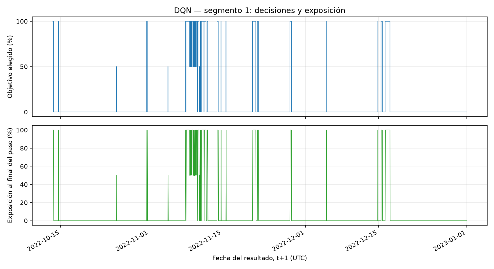
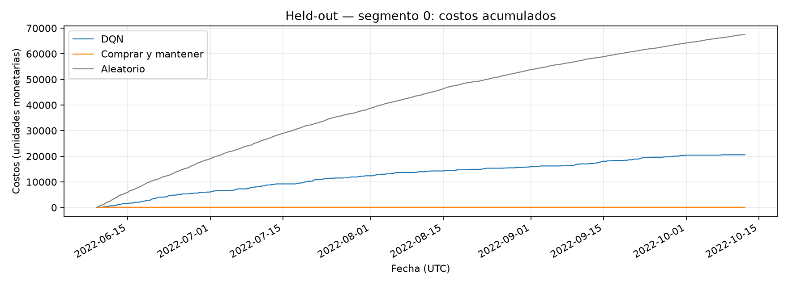
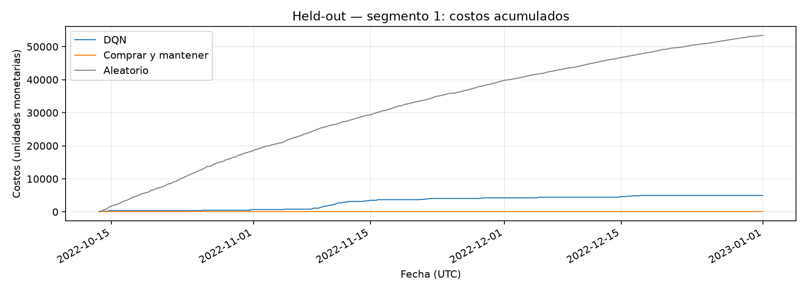

# Informe Final - Proyecto «Agente Inversor» (Actividad 4)

**Integración y Reproducibilidad:** 
**Fecha:** 21 de octubre de 2026

---

## 1. Formulación del Problema
El objetivo de este proyecto es formular un problema de inversión financiera como un Proceso de Decisión de Markov (MDP) y entrenar un agente de Reinforcement Learning (RL) para maximizar el retorno ajustado por riesgo y costos. El agente gestiona un capital inicial de $100.000 y decide en cada instante t qué proporción del capital exponer al mercado.

### Espacio de Acciones
Se definió un espacio de acciones discreto A = {0, 1, 2}, donde:
- **Acción 0:** Mantener 0 % invertido (Efectivo).
- **Acción 1:** Mantener 50 % invertido.
- **Acción 2:** Mantener 100 % invertido.

### Estado (Observación)
El estado contiene información procesada y estrictamente pasada para evitar lookahead. Incluye:
- Retorno de una hora (escalado).
- Distancia a la media móvil de 24 observaciones horarias (escalada).
- Volatilidad de 24 retornos horarios (escalada).
- Proporción real del capital invertido (entre 0 y 1).

---

## 2. Análisis de los Datos (EDA)
Se utilizaron datos históricos del par BTC/USDT de Bitfinex con frecuencia horaria. Tras la corrección de huecos, la división temporal se mantuvo intacta y completamente lookahead-safe:

| Partición | Filas | Segmentos continuos |
| :--- | :--- | :--- |
| Entrenamiento | 21.606 | 31 |
| Validación | 4.939 | 1 |
| Held-out | 4.916 | 2 |

El escalado y los indicadores se ajustaron utilizando únicamente el conjunto de entrenamiento.

---

## 3. Diseño del Entorno
El entorno de simulación fue construido bajo la interfaz de Gymnasium. Las características clave incluyen:
- **Costos de transacción:** Se cobra una comisión del 0,1 % (10 bps) sobre el importe negociado al realizar rebalanceos.
- **Prevención de lookahead:** En el instante t, el agente observa la información hasta el cierre y elige un objetivo. El movimiento del precio de t a t+1 se aplica sobre el capital mantenido *después* de deducir los costos.

---

## 4. Diseño e Iteración de la Recompensa
Se compararon experimentalmente dos funciones de recompensa (los costos ya están descontados del capital):
- **Simple:** `V_siguiente / V_actual - 1`
- **Logarítmica:** `log(V_siguiente / V_actual)`

Tras ejecutar entrenamientos con tres semillas (42, 123, 2026), se seleccionó la recompensa Simple debido a que presentó un retorno medio prácticamente igual (-57,10 % vs -57,11 %), pero con menor dispersión (13,59 pp vs 21,52 pp) y menor máximo drawdown (-60,39 % vs -63,29 %).

---

## 5. Algoritmo DQN y Entrenamiento
Se implementó una red neuronal DQN con la siguiente arquitectura e hiperparámetros:

| Parámetro | Valor |
| :--- | :--- |
| Red | 4 entradas → 64 ReLU → 64 ReLU → 3 salidas |
| Optimizador | Adam (LR: 0,0005) |
| Gamma | 0,99 |
| Batch size | 64 |
| Replay buffer | 20.000 transiciones |
| Sincronización target | Cada 500 actualizaciones |
| Exploración | Epsilon de 1,00 a 0,05 en 20.000 pasos |
| Pérdida | Smooth L1 |

### Selección de Modelo Congelado
Entre las semillas evaluadas, se seleccionó el checkpoint de la semilla 123 (Retorno de validación: -42,54%, Max Drawdown: -48,69%). Este modelo fue congelado y se generó su SHA256 (`e9e7939454641152937860a55c86585b956b498a7bc3892f12aa47678fb3a525`) para garantizar la integridad antes de evaluar el held-out.

---

## 6. Evaluación frente a Baselines (Held-Out)
La evaluación final se realizó en el conjunto held-out, dividido en dos segmentos independientes, comparando el agente DQN contra las estrategias "Comprar y Mantener" (Buy and Hold) y "Aleatoria".

| Segmento | Estrategia | Retorno | Max Drawdown | Costos |
| :--- | :--- | :--- | :--- | :--- |
| 0 | DQN | -32,20 % | -34,37 % | 20.586,41 |
| 0 | Comprar/Mantener | -36,84 % | -41,67 % | 99,90 |
| 0 | Aleatorio | -75,36 % | -75,53 % | 67.471,94 |
| 1 | DQN | -13,40 % | -23,18 % | 4.970,77 |
| 1 | Comprar/Mantener | -10,09 % | -27,03 % | 99,90 |
| 1 | Aleatorio | -63,60 % | -64,85 % | 53.413,06 |

### Análisis Gráfico (Curvas de Capital y Drawdown)
A continuación se evidencia el comportamiento temporal del agente frente a las estrategias base en ambos segmentos del conjunto de evaluación.

### Evolución de Acciones y Posiciones
Las siguientes figuras muestran cómo el agente ajustó su nivel de exposición (efectivo, 50%, o 100%) a lo largo de los segmentos.

### Evolución de Costos
Se ilustra la progresión de los costos acumulados por concepto de comisiones de transacción (0,1 %) generados por las acciones del agente a lo largo del tiempo.

---

## 7. Limitaciones y Anomalías (Reward Hacking)
- **Inactividad:** El agente DQN presentó una exposición media real muy baja (21,93 % y 8,13 % en los segmentos). Logró un menor drawdown, pero no demostró superioridad consistente en rentabilidad absoluta frente a Comprar y Mantener.
- **Anomalías:** A pesar de mantenerse mayormente en efectivo, el agente sufrió pérdidas horarias importantes durante sus pocas exposiciones al 100%.
- **Limitaciones técnicas:** La simulación omite spread de mercado y deslizamiento (slippage), lo cual afectaría aún más al agente debido a sus altos costos por rebalanceo constante.

---

## 8. Reflexiones 

1. **Resultado más sorprendente:** Me sorprendió que el agente optara por una inactividad casi total en datos no vistos, minimizando el drawdown pero perdiendo frente al baseline pasivo. Demuestra cómo los costos de transacción del 0,1% penalizan severamente el trading activo.
2. **Decisión metodológica de mayor impacto:** La estricta separación cronológica y la corrección de huecos en los datos. Garantizar que el held-out fuera verdaderamente lookahead-safe derrumbó el falso optimismo del entrenamiento.
3. **Qué cambiaría:** Implementaría una plataforma de MLOps (ej. Weights & Biases) desde el primer día para automatizar el seguimiento de la convergencia de la recompensa y simplificar la integración.
4. **Comportamiento sin explicar:** Las pérdidas abruptas durante las pocas ventanas en las que el agente decidió exponerse al 100%. Cuesta determinar si fueron trampas del mercado o ruido en la política de la red.
5. **Diferencia teoría vs aplicación:** En la teoría clásica, el entorno es estacionario. En series temporales financieras como BTC/USDT, el cambio constante de régimen de mercado hace que un agente robusto en validación fracase en datos futuros invisibles.

## 9. Instrucciones de Reproducibilidad
El repositorio está encapsulado utilizando el gestor `uv` con Python 3.12.10 y PyTorch 2.14.1+cpu. Los comandos de reconstrucción de datos (`src.preparar_datos_corregidos`) validan la identidad de los CSV mediante tolerancias numéricas estrictas. La congelación del modelo garantiza la selección algorítmica de la semilla 123 (SHA256: `e9e7939...`) sin intervención manual tras observar la validación.

