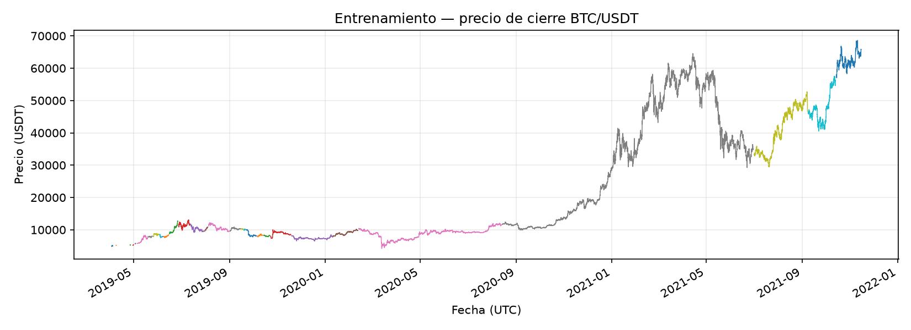
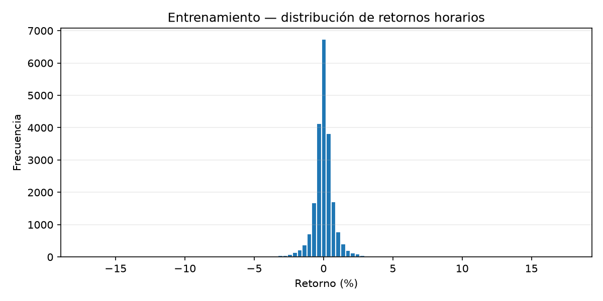
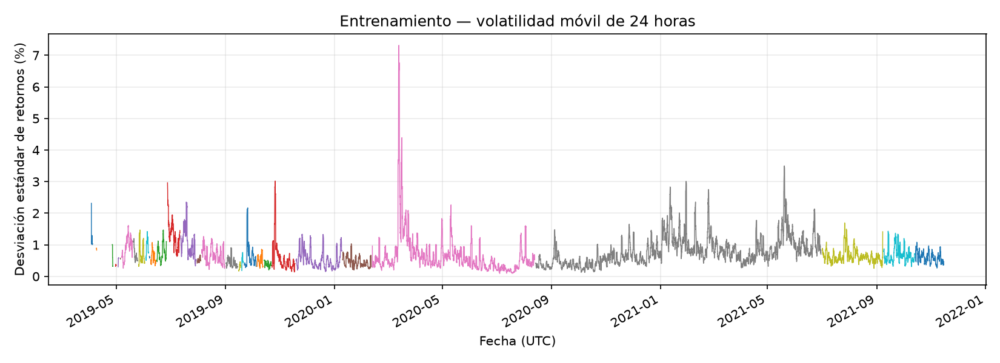

# Actividad 1 — Datos, análisis exploratorio y formulación del estado

## 1. Objetivo

Preparar los datos históricos de BTC/USDT, analizar su comportamiento y definir las variables que observará el agente inversor. El procesamiento respeta el orden temporal y utiliza información disponible hasta el cierre de cada hora.

Este análisis documenta el conjunto de entrenamiento corregido utilizado en el proyecto integrado.

## 2. Fuente y trazabilidad

La fuente utilizada fue Bitfinex2, mediante el descargador de `gym-trading-env`. Se sustituyó Binance por restricciones de acceso desde el entorno original de ejecución.

La entrega inicial contenía 32.953 registros antes del calentamiento de indicadores y 32.929 observaciones procesadas. El archivo original `.pkl` no estaba disponible en los archivos recibidos.

Por ello, el procesamiento corregido recuperó las columnas OHLCV de los CSV originales. No pudieron recuperarse las 24 observaciones iniciales que ya habían sido descartadas.

La cobertura original disponible no comienza en enero de 2019. El primer registro de los CSV recibidos corresponde al 12 de marzo de 2019; después de corregir los indicadores y aplicar el calentamiento por segmento, el entrenamiento útil comienza el 3 de abril de 2019.

## 3. Calidad y tratamiento de los datos

El procesamiento verifica:

- Fechas ordenadas y sin duplicados.
- Valores OHLCV numéricos y finitos.
- Precios positivos y volumen no negativo.
- Coherencia entre apertura, máximo, mínimo y cierre.
- Continuidad horaria para el cálculo de indicadores.

Cada intervalo distinto de una hora inicia un nuevo segmento. Los indicadores se calculan de forma independiente dentro de cada segmento, sin rellenar horas ausentes ni calcular retornos a través de huecos.

Se descartan las primeras 24 observaciones de cada segmento porque la volatilidad requiere 24 retornos horarios consecutivos. Los segmentos sin suficiente historial no aportan filas útiles.

Los huecos entre filas retenidas incluyen tanto discontinuidades de la fuente como observaciones descartadas durante el calentamiento; no deben interpretarse directamente como horas ausentes en el mercado.

## 4. Particiones temporales

Se conservaron las fronteras temporales de la división original. No se volvieron a calcular porcentajes después de retirar observaciones.

| Partición | Filas corregidas | Inicio UTC | Fin UTC | Segmentos |
|---|---:|---|---|---:|
| Entrenamiento | 21.606 | 2019-04-03 03:00 | 2021-11-15 04:00 | 31 |
| Validación | 4.939 | 2021-11-15 05:00 | 2022-06-08 23:00 | 1 |
| Evaluación final | 4.916 | 2022-06-09 00:00 | 2022-12-31 23:00 | 2 |

Las medias y desviaciones utilizadas para escalar los indicadores se ajustaron exclusivamente con entrenamiento.

El script de análisis exploratorio lee únicamente `resultados_corregidos/train.csv` y el resumen del procesamiento. No lee los CSV de validación ni evaluación final.

Este análisis actualizado se documentó después de la evaluación final del proyecto; no se utilizó para modificar el modelo congelado, los indicadores ni sus hiperparámetros.

## 5. Resultados del análisis exploratorio

### 5.1 Estadísticas de los retornos horarios

Los valores se expresan en las unidades originales, recuperadas mediante la transformación inversa del escalado de entrenamiento.

| Medida | Valor |
|---|---:|
| Retorno horario medio | 0,0153 % |
| Desviación estándar horaria | 0,8545 % |
| Retorno horario mínimo | −17,2184 % |
| Retorno horario máximo | 17,6063 % |
| Asimetría | −0,2858 |
| Exceso de curtosis | 41,4686 |

El retorno medio positivo es pequeño respecto a la desviación estándar. No representa el retorno de una estrategia ni garantiza rentabilidad después de costos.

La asimetría negativa indica una ligera inclinación hacia retornos negativos. El elevado exceso de curtosis muestra colas mucho más pesadas que las de una distribución normal, coherentes con la presencia de movimientos extremos.

### 5.2 Evolución del precio



Se observan fases ascendentes, caídas y recuperaciones. Durante 2021 aparecen aumentos pronunciados, una caída importante y una recuperación posterior.

Estos cambios muestran que el comportamiento del precio varía durante el período y respaldan evaluar al agente en períodos posteriores separados cronológicamente. La gráfica por sí sola no constituye una prueba estadística de estacionariedad.

Los distintos colores identifican segmentos horarios continuos. No representan estrategias, clases ni categorías de mercado.

### 5.3 Distribución de retornos



La mayor parte de los retornos se concentra cerca de cero. Los movimientos extremos tienen frecuencias pequeñas y resultan poco visibles en la escala lineal de la figura.

Por esta razón, la interpretación de la distribución se complementa con sus valores mínimo y máximo y con el exceso de curtosis. La concentración central no implica ausencia de riesgo.

### 5.4 Volatilidad reciente



La volatilidad presenta períodos relativamente tranquilos y episodios de variación intensa. Destaca un pico alrededor de marzo de 2020 y otros episodios durante 2021.

La medida corresponde a la desviación estándar de los retornos horarios dentro de una ventana de 24 horas; no es un retorno acumulado de 24 horas ni una volatilidad anualizada.

Estos cambios respaldan incluir una medida de variación reciente en el estado del agente, aunque no demuestran que esta variable permita anticipar movimientos futuros.

### 5.5 Figuras complementarias

El análisis también genera las siguientes figuras:

- [Retornos horarios de entrenamiento](../eda_actividad1/retornos_entrenamiento.png).
- [Volumen reportado por la fuente](../eda_actividad1/volumen_entrenamiento.png).

El volumen se conserva para el análisis exploratorio, pero no forma parte del estado utilizado por el DQN.

## 6. Formulación y justificación del estado

El agente recibe cuatro valores:

| Variable | Definición | Información que aporta |
|---|---|---|
| `retorno_1h` | Precio de cierre actual dividido por el anterior, menos uno | Movimiento reciente del precio |
| `distancia_media_24h` | Precio actual dividido por la media de los últimos 24 cierres, menos uno | Posición del precio respecto a su nivel reciente |
| `volatilidad_24h` | Desviación estándar muestral de los últimos 24 retornos horarios | Intensidad de la variación reciente |
| `posicion_actual` | Proporción efectiva del capital invertido al observar el estado | Exposición existente y contexto para calcular el siguiente ajuste |

Las tres variables de mercado se estandarizan con la media y desviación del entrenamiento. La posición actual la incorpora el entorno y permanece entre 0 y 1.

La posición efectiva puede diferir del objetivo elegido anteriormente debido al movimiento del precio. Por ello, no está limitada a los valores 0, 0,5 y 1.

La ventana de 24 horas representa una referencia diaria para datos horarios. Es una elección de diseño; no se afirma que sea la ventana óptima.

Esta representación compacta combina movimiento reciente, nivel relativo, variación y exposición. Su utilidad predictiva no queda demostrada por el análisis descriptivo y no garantiza que el estado contenga toda la información necesaria para decidir.

## 7. Prevención de información futura

Los indicadores utilizan únicamente el cierre actual y observaciones anteriores dentro del mismo segmento continuo.

Al cierre de la hora t, el agente observa el estado y elige su exposición objetivo. El entorno aplica los costos del ajuste y después el movimiento del precio desde t hasta t+1.

El escalado se ajusta con entrenamiento y se aplica sin volver a estimar sus parámetros en validación o evaluación final.

## 8. Evidencias y ejecución

Archivos principales:

- `src/features.py`: preparación, indicadores y escalado.
- `src/eda_actividad1.py`: análisis exploratorio del entrenamiento corregido.
- `resultados_corregidos/resumen.json`: trazabilidad y parámetros de escalado.
- `eda_actividad1/estadisticas_entrenamiento.csv`: estadísticas descriptivas en unidades originales.
- `eda_actividad1/segmentos_entrenamiento.csv`: fechas y tamaño de cada segmento retenido.
- `eda_actividad1/resumen_eda.json`: resumen de esta ejecución.
- `eda_actividad1/*.png`: cinco figuras del análisis.

Desde la carpeta principal del proyecto:

```powershell
python -m py_compile .\src\eda_actividad1.py
python -m src.eda_actividad1
```

El script crea la carpeta `eda_actividad1` y rechaza sobrescribirla si ya existe. Para repetir el análisis, conservar primero la salida anterior renombrando esa carpeta.

La ejecución comprueba que los retornos recuperados del escalado coincidan con los calculados a partir de los cierres en las filas consecutivas disponibles.

## 9. Limitaciones

- No se dispone del archivo original `.pkl` ni de las primeras 24 observaciones descartadas.
- La eliminación de calentamientos reduce la cobertura útil, especialmente en períodos con discontinuidades frecuentes.
- Las estadísticas describen las observaciones retenidas de entrenamiento, no una serie completa sin huecos.
- Los movimientos extremos observados no se atribuyen automáticamente a eventos concretos ni se certifican como libres de errores de la fuente.
- No se realizó una comparación de distintas ventanas temporales ni una selección experimental de indicadores.
- Los resultados descriptivos no prueban capacidad predictiva ni rentabilidad del agente.

## 10. Conclusión

El procesamiento corregido proporciona 21.606 observaciones útiles de entrenamiento distribuidas en 31 segmentos horarios continuos. El análisis muestra retornos concentrados cerca de cero, movimientos extremos y cambios en la volatilidad.

El estado elegido resume movimiento reciente, nivel relativo del precio, variación y exposición actual. La separación temporal, el escalado ajustado con entrenamiento y el tratamiento independiente de los segmentos permiten utilizar esta representación sin calcular indicadores a través de huecos ni incorporar precios futuros.

## 11. Referencia de la herramienta de descarga

Gym Trading Env. Documentación del descargador de datos:

https://gym-trading-env.readthedocs.io/en/latest/download.html